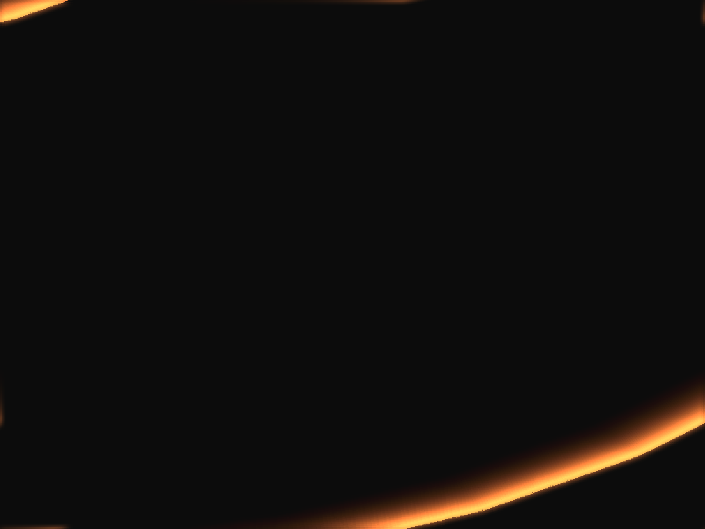

<div align="center">

# 🌊 Fossil Waves

**Ondas concêntricas em expansão, desenhadas em C com raylib + GLSL.**

Uma animação procedural de ondas que crescem e se acumulam sobre um fundo escuro,
com um efeito de *glow* aplicado em pós-processamento.



</div>

---

## ✨ Sobre

**Fossil Waves** é um experimento visual escrito em **C** usando a biblioteca
[raylib](https://www.raylib.com/). Elipses concêntricas ("gotas") são desenhadas
em uma *render texture* acumulativa: a cada *frame* um overlay preto translúcido
vai apagando lentamente o desenho anterior, criando um rastro que se desvanece.

O resultado é uma textura que guarda o histórico das ondas, suavizada por um
*shader* de *glow* (desfoque gaussiano 7×7) aplicado em pós-processamento.

## 🎨 Características

- ✏️ Elipses concêntricas desenhadas em tempo real (`DrawEllipseLines`)
- 🫧 Renderização acumulativa em `RenderTexture2D` — o desenho nunca é apagado por completo
- ✨ *Shader* de *glow* em GLSL (pós-processamento)
- 🎛️ Parâmetros ajustáveis via `#define` (cor, quantidade, velocidade, etc.)
- 🧰 Build gerenciado por **CMake** — o raylib é baixado automaticamente via `FetchContent`
- 🐧 Suporte a **Wayland** e **X11** (GLFW)

## 🚀 Como compilar e rodar

### Pré-requisitos

- [CMake](https://cmake.org/) ≥ 3.16
- Um compilador C (GCC ou Clang)
- Git

> O **raylib 5.5** é baixado e compilado automaticamente pelo CMake
> (`FetchContent`), então não é necessário instalar nada além do CMake e do compilador.

### Linux / macOS

```sh
cmake -B build -DCMAKE_BUILD_TYPE=Release
cmake --build build -j
./build/fossil-waves
```

> Por padrão, o build usa o backend **Wayland** no Linux. Para usar **X11**,
> configure com:
>
> ```sh
> cmake -B build -DGLFW_BUILD_WAYLAND=OFF -DGLFW_BUILD_X11=ON
> ```

### Windows

```sh
cmake -B build
cmake --build build --config Release
build\Release\fossil-waves.exe
```

## 🧭 Estrutura do projeto

```
.
├── CMakeLists.txt     # Build e dependências (raylib via FetchContent)
├── assets/
│   └── screen/
│       └── sshot.png  # Screenshot da animação
└── src/
    └── main.c         # Lógica da animação + shader de glow
```

## 🎛️ Ajustes rápidos

Os principais parâmetros ficam no topo do `src/main.c`:

| Constante            | O que controla                              |
| -------------------- | ------------------------------------------- |
| `DROPS_SIZE`         | Número máximo de ondas simultâneas          |
| `SPAWN_TIME_MIN/MAX` | Intervalo (segundos) entre novas ondas      |
| `MAX_ELIPSE_RADIUS`  | Raio máximo antes de a onda "morrer"        |
| `WAVE_COLOR`         | Cor das ondas (RGB)                         |

## 📄 Licença

Distribuído sob a licença [MIT](LICENSE).
